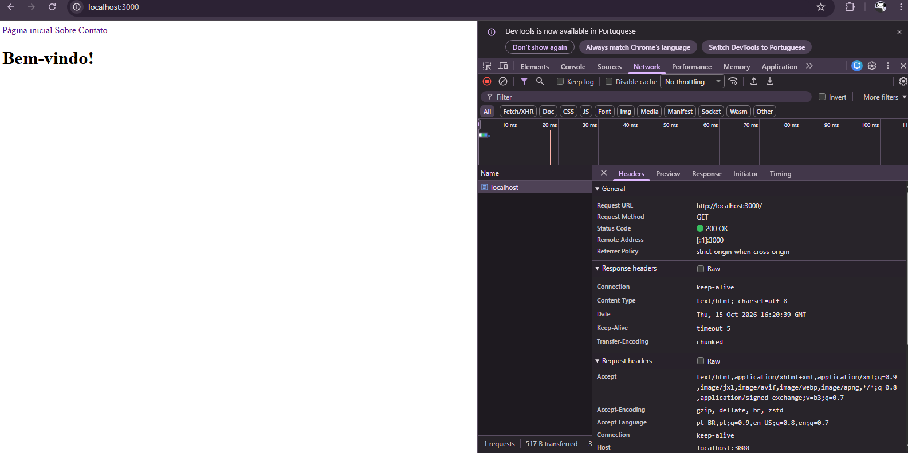
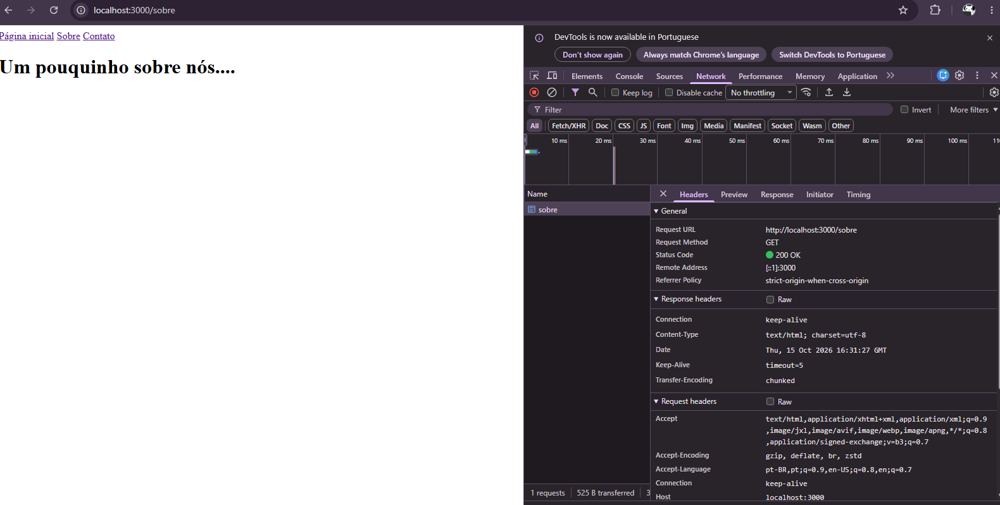
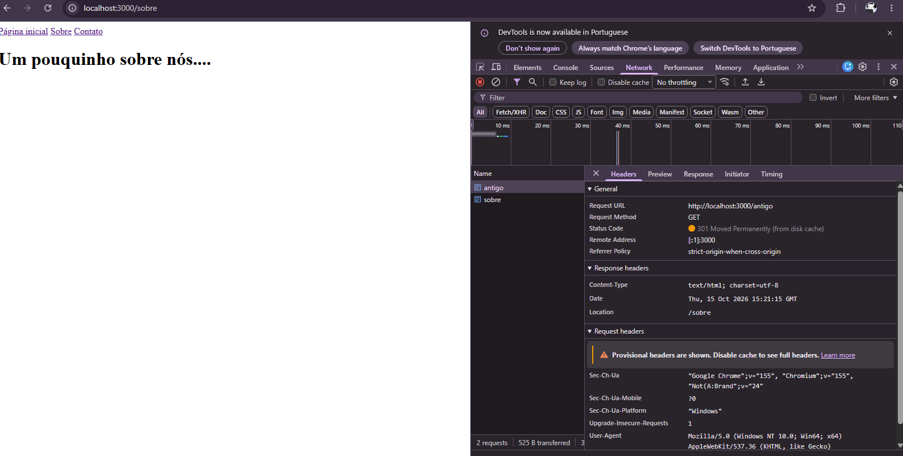
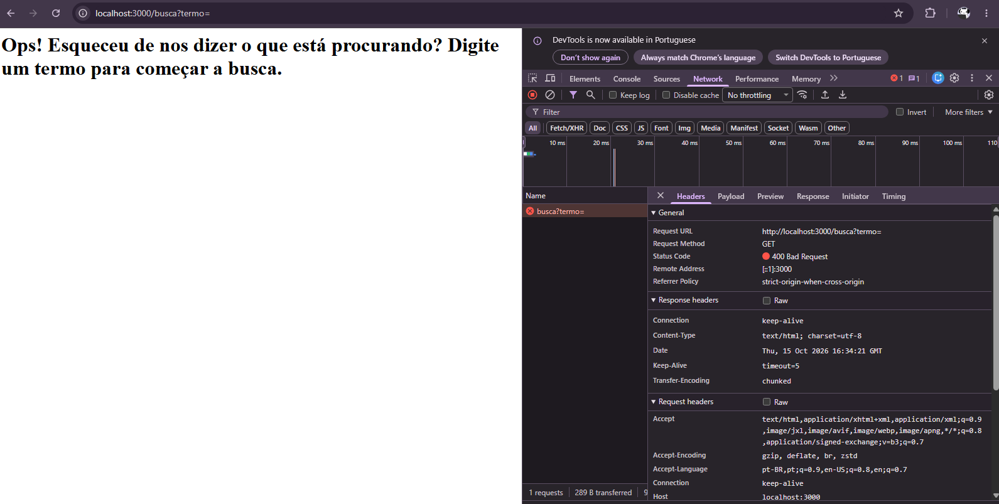
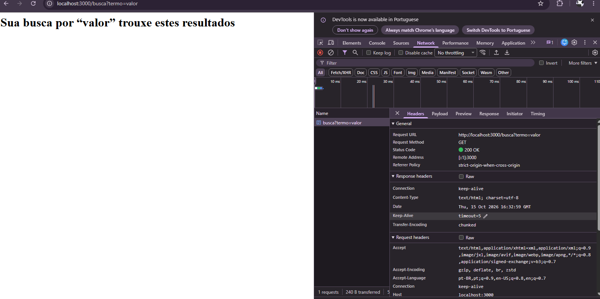
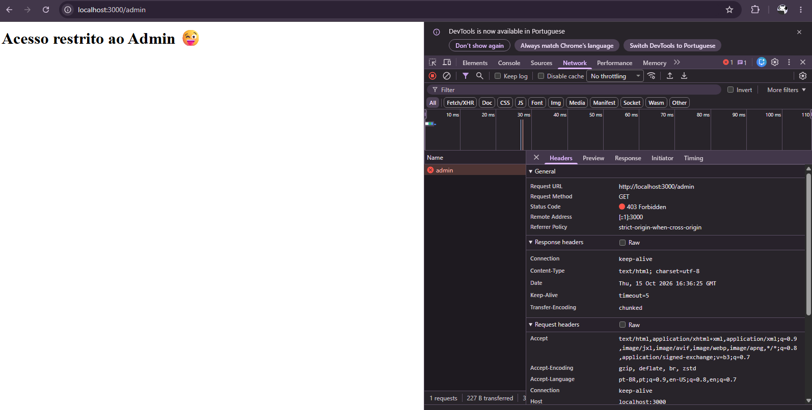
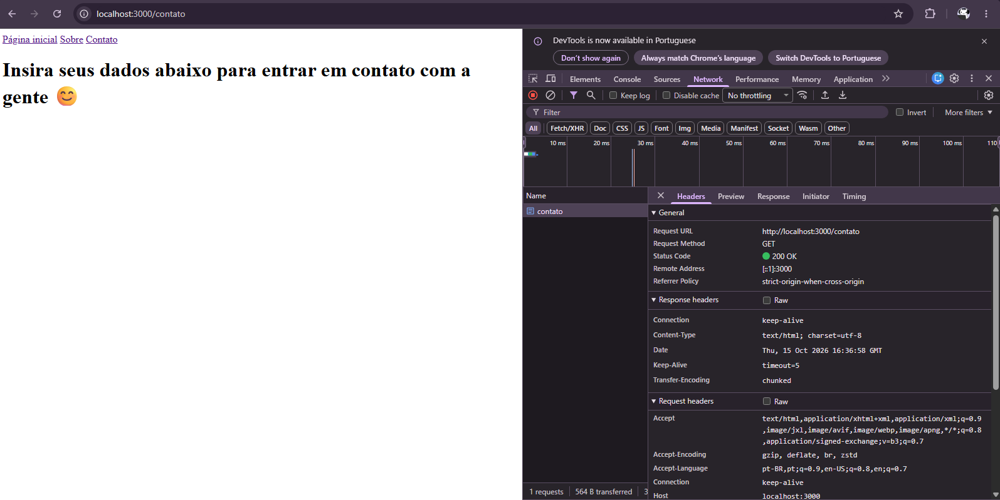
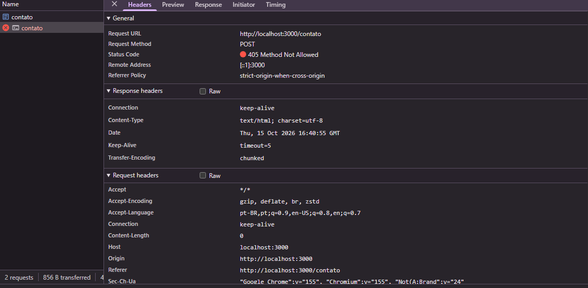
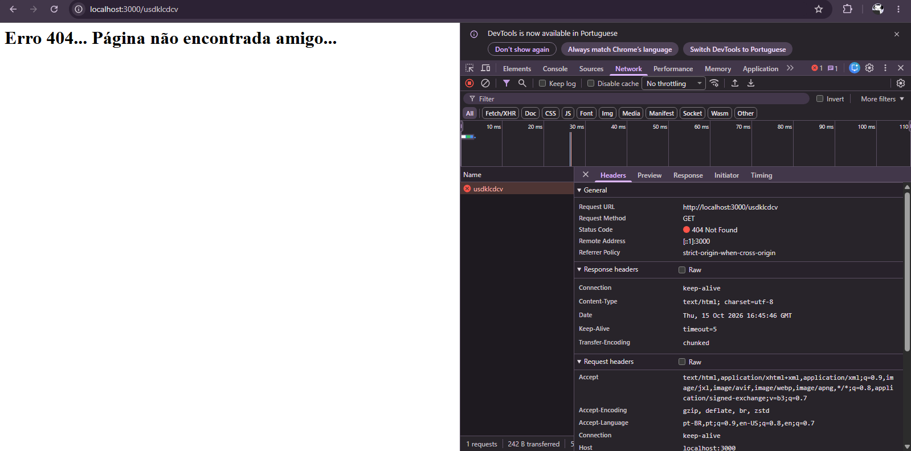

# Protocolo http: requisição, resposta, métodos, status e cabeçalho 

## Fundamentação

### Http (Hypertext Transfer Protocol)


#### Protocolo de comunicação entre cliente e servidor. Quando você digita uma URL, o navegador usa o DNS para traduzir o nome do site em um endereço IP, permitindo localizar o servidor, estabelecer a conexão, e então o cliente envia uma requisição (HTTP request) enquanto o servidor processa e retorna a resposta (HTTP response).

* REFATORANDO. Understanding the HTTP protocol. 2021. 1 vídeo (aprox. [10min]). Publicado pelo canal Refatorando. Disponível em: https://www.youtube.com/watch?v=PcHbyGVoqZk. Acesso em: 15 out. 2026.

### Anatomia da requisição e da resposta

#### A anatomia da requisição e da resposta divide-se em linha inicial, cabeçalhos e corpo. A mensagem HTTP divide-se em três partes: a linha inicial (que define o status, como 200 OK), os cabeçalhos (informações de suporte, como o navegador utilizado e o tipo de arquivo) e o corpo (o conteúdo real que é enviado ou recebido, como o código HTML da página).
Exemplo:

* **linha inicial**

```
res.writeHead(200, { 'Content-Type': 'text/html' });

```
Quando o Node.js executa essa linha, ele pega o número 200 e traduz automaticamente para o padrão do protocolo HTTP, montando a linha inicial da resposta HTTP/1.1 200 OK
* HTTP/1.1 = A versão do protocolo que o servidor está usando
* 200 = O código de status dizendo que deu certo.
* OK = Descrição.

* **Cabeçalhos** como `Content-Type: text/html; charset=utf-8 `
* **Corpo** com o conteúdo retornado, por exemplo: `<h1>Página Inicial</h1>`

* MOZILLA DEVELOPER NETWORK (MDN). Mensagens HTTP. Disponível em: https://developer.mozilla.org/pt-BR/docs/Web/HTTP/Guides/Messages. Acesso em: 15 out. 2026.

### Métodos

* GET
#### Solicita a representação de um recurso específico e retorna apenas dados. 

* POST
#### Cria/Posta algo novo

* PUT
#### Pega os dados colocados  e substitui inteiramente o recurso que já lá estava, caso seja colocado mais de uma vez haverá dados duplicados.

* DELETE
#### Remove um recurso específico.

* PATCH
#### Diferente do PUT (que substitui tudo), o PATCH modifica apenas os campos específicos que forem enviados.

#### **Métodos seguros** (GET) apenas leem dados sem alterar o servidor, enquanto **métodos idempotentes**  (PUT, DELETE) podem alterar o servidor, mas garantem o mesmo resultado final mesmo se repetidos. Todos os métodos seguros também são idempotentes porém nem todos são seguros.


* MOZILLA DEVELOPER NETWORK (MDN). Métodos de requisição HTTP. Disponível em: https://developer.mozilla.org/pt-BR/docs/Web/HTTP/Reference/Methods. Acesso em: 15 out. 2026.

* MOZILLA DEVELOPER NETWORK (MDN). Seguro. In: Glossário do MDN Web Docs. Disponível em: https://developer.mozilla.org/pt-BR/docs/Glossary/Safe. Acesso em: 15 out. 2026.

### Códigos de Status:

### Família

* (100 – 199) - Respostas Informativas 
* (200 – 299) - Respostas bem-sucedidas 
* (300 – 399) - Mensagens de redirecionamento  
* (400 – 499) - Respostas de erro do cliente  
* (500 – 599) - Respostas de erro do servidor 
* 200 (OK) - Solicitação bem sucedida
* 201 (CREATED)  - O pedido foi processado com sucesso e criou um novo recurso no servidor (comum após POST e PUT).
* 301 (Moved Permanently) - Quando uma URL é  alterada permanentemente, fornecendo uma nova URL
* 302 (Found) - Modificação temporária com o fornecimento de um substituto
* 304 (Not Modified) - Usado para cache, ela indica que a resposta não mudou e o cliente pode continuar a usar a versão local
* 400 (Bad request) - O servidor recusou-se a processar a requisição devido a um erro cometido pelo cliente (como dados mal formatados)
* 401(Unauthorized) - Requer autenticação do cliente para libertar o acesso à resposta.
* 403(Forbidden) - O acesso ao conteúdo é negado apesar do servidor conhecer a identidade do cliente, ele não tem permissão para acessar o recurso
* 404(Not Found) - A Página não encontrada
* 405 (Method Not Allowed) - O método enviado não é suportado pelo recurso de destino
* 500(Internal Server Error) - O servidor achou um erro que ele não sabe lidar

### Diferença

### 401 e 403
A diferença entre o 401 e o 403 está na autenticação: no 401 o cliente não está identificado e precisa de se autenticar, enquanto no 403 o servidor já conhece a sua identidade, mas nega o acesso por que ele não tem permissão.
### 301 e 302
Já entre o 301 e o 302, a diferença é a duração da mudança: o 301 indica que a URL foi alterada permanentemente para um novo endereço, enquanto o 302 indica uma mudança temporária, mantendo a URL original para acessos futuros.

* MOZILLA DEVELOPER NETWORK (MDN). Códigos de status de respostas HTTP. Disponível em: https://developer.mozilla.org/pt-BR/docs/Web/HTTP/Reference/Status. Acesso em: 15 out. 2026.

### Cabeçalho

#### Os cabeçalhos servem para passar informações adicionais entre o cliente e o servidor numa requisição ou resposta, permitindo configurar o comportamento da comunicação, descrever dados ou gerir o fluxo da aplicação.

* Content-Type: Indica o formato dos dados enviados no corpo da mensagem (ex: application/json).
* Content-Length: Informa o tamanho exato da mensagem em bytes.
* Location: Aponta a URL de redirecionamento ou o endereço do novo recurso criado.
* Allow: Lista os métodos HTTP suportados por um recurso.
* Cache-Control: Define as regras de armazenamento em cache para otimizar pedidos.
* User-Agent: Identifica o software e o sistema operativo do cliente que fez o pedido.
* Accept: Especifica quais os formatos de dados que o cliente aceita como resposta.

MOZILLA DEVELOPER NETWORK (MDN). Cabeçalhos HTTP. Disponível em: https://developer.mozilla.org/pt-BR/docs/Web/HTTP/Reference/Headers. Acesso em: 15 out. 2026.

### HTTP é stateless

#### Sim, o HTTP é stateless (sem estado). Cada requisição é totalmente independente; o servidor não guarda histórico ou contexto anterior, tratando cada pedido como se fosse o primeiro.

### Diferença HTTP e HTTPS

#### O HTTP (HyperText Transfer Protocol) é o protocolo base que define as regras para a comunicação entre o navegador do cliente e o servidor web, trocando dados em texto simples. Já o HTTPS (HTTP Secure) é a extensão segura dessa tecnologia: antes de qualquer transferência de dados, o cliente e o servidor estabelecem uma conexão protegida por criptografia, garantindo a privacidade e a integridade das informações.

* AMAZON WEB SERVICES (AWS). HTTP vs. HTTPS: diferença entre protocolos de transferência. Disponível em: https://aws.amazon.com/pt/compare/the-difference-between-https-and-http/. Acesso em: 15 out. 2026.

## Evidencias Print Descrição 

* **Página Inicial**

#### O print demonstra a requisição para a rota `/`, confirmando a resposta com sucesso através do status `200 OK`

* **Sobre**

#### O print demonstra a requisição para a rota `/sobre`, confirmando a resposta com sucesso através do status `200 OK`

* **antigo**

#### O print demonstra o redirecionamento permanente com o status `301 Moved Permanently`

* **busca sem o termo**

#### Exibição do estado `400 Bad Request` indicando que o termo de busca não foi fornecido

* **busca termo=valor**

#### Exibição do estado `200 OK` indicando que o termo de busca foi digitado como "valor"

* **admin**

#### Confirmação de acesso negado através do status `403 Forbidden` ao tentar aceder à rota restrita de administração

* **contato GET**

#### Exibição do estado `200 OK` confirmando a resposta

* **contato Outro**

#### Resposta com o estado `405 Method Not Allowed` ao enviar um método não suportado

* **Not Found**

#### Rota inexistente com o estado `404 Not Found`

* MARKDOWN LIVE PREVIEW. Disponível em: https://markdownlivepreview.com/. Acesso em: 14 out. 2026.

#### Assistente de IA (Gemini) Data de uso: 15 out. 2026.
Finalidade: ajuda no entendimento nos conceitos do MDN além de ajuda nas rotas que tive dificuldades na execução
Arquivos impactados: src/routes/routes.js; README.me

### Conclusão
#### Após o estudo, percebi que a principal mudança no servidor que eu faria seria a criação de rotas mais específicas para cada tipo de necessidade, aplicando códigos de status e cabeçalhos corretos em cada fluxo. Pretendo colocar este conhecimento em prática no desenvolvimento do nosso Projeto Integrador (PI), tornando a API mais completa.


